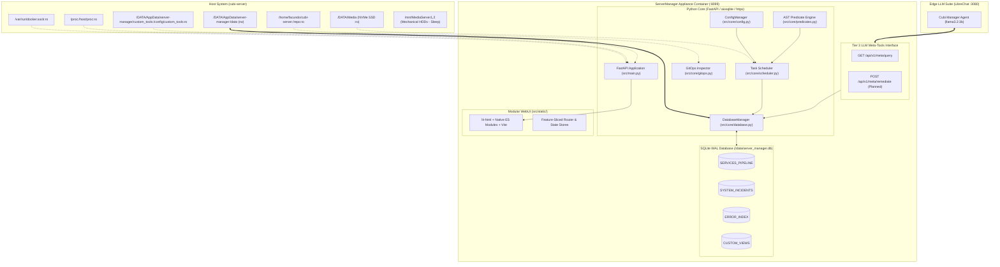
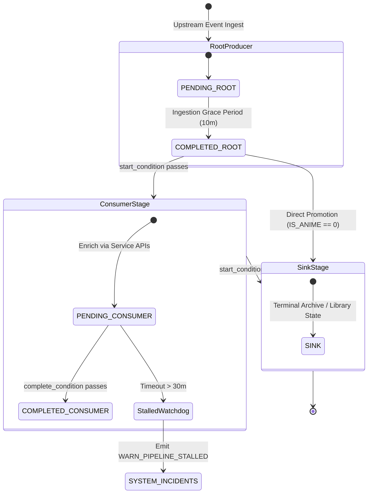
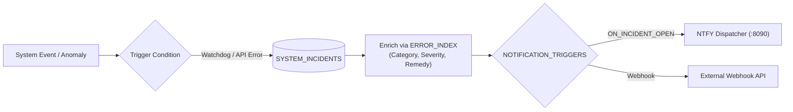

# ServerManager Platform Architecture & System Blueprint

**Document Version:** `v0.1.7`  
**Appliance Port:** `8099`  
**Primary Architecture:** Containerized FastAPI + SQLite WAL + Modular ES / `lit-html` WebUI  
**Status:** Living Architectural Specification  
**Language Standard:** English (Universal Codebase Standard)

---

## 1. Executive Summary & Appliance Scope

`server-manager` is an autonomous, containerized administration, universal telemetry, and cross-service pipeline orchestrator designed for homelab and media server environments.

Operating as an independent appliance on port **8099**, it bridges disparate homelab automation services (e.g., Sonarr, Radarr, Shoko Server, Jellyfin, AniBridge) into a unified, extensible data pipeline without polluting underlying services or requiring hardcoded schema migrations.

### Non-Negotiable Operational Constraints

1. **Read-Only Host Mounts (`:ro`)**:
   The container operates strictly in passive observation mode over host resources (`/DATA:ro`, `/var/run/docker.sock:ro`, `/proc:/host/proc:ro`, `/repo:ro`).
2. **Pragmatic Anti-Wake Storage Policy**:
   Automated background daemons, ingestion loops, and health checks MUST NEVER trigger physical spin-up of idle mechanical hard drives (`/mnt/MediaServer1`, `/mnt/MediaServer2`). All file evaluations rely on NVMe SSD symlink inspection (`os.readlink()`), `/host/proc/diskstats`, and in-memory caches.
3. **Decoupled Three-Tier Telemetry Architecture (Rule 9)**:
   - **Tier 1 (Autonomous Background Ingestion)**: Ingestion tasks poll upstream APIs, normalize payloads, resolve tags, and write structured records into SQLite.
   - **Tier 2 (Structured Database Storage)**: Local SQLite database (`SERVICES_PIPELINE`, `SYSTEM_INCIDENTS`, `ERROR_INDEX`, `CUSTOM_VIEWS`) stores pre-filtered records with concurrency handled via WAL mode.
   - **Tier 3 (Stateless LLM Agent)**: Edge AI agents (LibreChat / Ollama `llama3.2:3b`) interact **strictly and exclusively** with Tier 2 structured data via management APIs (`/api/v1/meta/query`). The LLM never reads raw container logs or executes arbitrary host commands.
4. **Zero Backward Compatibility / Zero Duct-Tape Standard**:
   Architectural refactoring eliminates dead code, legacy shims, and brittle fallback logic. All schema evolutions and endpoint namespaces are explicit and strictly typed.

---

## 2. End-to-End System Topology



---

## 3. Container Architecture & Host Mounts

The container runs as an unprivileged service (`PUID=1000`, `PGID=1000`, `UMASK=002`) packaged with Python 3.12-slim and built-in static WebUI assets.

### Mount Specifications

| Host Path | Container Path | Mode | Purpose |
| :--- | :--- | :---: | :--- |
| `/DATA/AppData/server-manager` | `/data` | `rw` | Persistent storage: `server_manager.db` (WAL mode) and `settings.json`. |
| `/DATA/AppData/server-manager/custom_tools` | `/config/custom_tools` | `ro` | Sandboxed executable scripts (`.py`, `.sh`) triggered on operator demand. |
| `/var/run/docker.sock` | `/var/run/docker.sock` | `ro` | Passive container health, image status, and container state verification. |
| `/proc` | `/host/proc` | `ro` | Passive host telemetry: CPU load, memory utilization, and disk I/O stats. |
| `/home/facundo/cubi-server` | `/repo` | `ro` | Read-only GitOps tracking (`HEAD` commit, current branch, working tree state). |

---

## 4. Universal Dynamic Multi-Pipeline Engine

The core data structure is the dynamic pipeline table (`SERVICES_PIPELINE`), designed to ingest and correlate records from any upstream automation tool without schema lock-in.

### 4.1 Dynamic Schema Mapper & Strict Sanitization
- Upstream service payloads vary in naming and nesting. The schema mapper allows administrators to map any JSON attribute into SQLite columns.
- **SQL Sanitization**: Target column names must strictly match the regex `^[A-Z0-9_]+$`. Any column violating this pattern is rejected at the API layer.
- **System Reserved Columns**: The following columns are protected and managed exclusively by the core engine:
  - `ID`: Autoincrement primary key.
  - `PIPELINE_KEY`: Unique tracking identifier across services (e.g. `sonarr:1284`).
  - `STAGE`: Current progression stage semantic slug (TEXT, immutable identifier).
  - `STATUS`: Progression state (`PENDING`, `COMPLETED`, `SINK`).
  - `LAST_UPDATED`: Current ISO timestamp.
- **Automated DDL Evolution**: Saving field mappings automatically triggers non-destructive SQLite migrations:
  ```sql
  ALTER TABLE SERVICES_PIPELINE ADD COLUMN "<COLUMN_NAME>" <DATA_TYPE>;
  ```
- **Column Renaming & Consolidation**: Renaming a column in settings updates the table schema (`RENAME COLUMN`) and merges existing data without loss.

### 4.2 Namespaced Multi-Enrichment Architecture
Primary events from services like Sonarr or Radarr (e.g., `/api/v3/history`) frequently provide only foreign keys (`seriesId`, `episodeId`).
- `ServiceConfig.enrichment_endpoints` supports discrete namespaces:
  ```json
  "enrichment_endpoints": {
    "series": "/api/v3/series/{seriesId}",
    "episode": "/api/v3/episode/{episodeId}"
  }
  ```
- Payloads are nested under their namespace key in the ingestion context dictionary:
  - `context["series"]` contains series-level attributes.
  - `context["episode"]` contains episode-level attributes.
- This eliminates attribute collisions (such as `series.title` vs `episode.title`).

### 4.3 Generic Dotted-Path List Projection (`extract_dotted_value`)
- Nested structures and arrays of objects are extracted using mandatory `[*]` array traversal syntax (e.g., `movie.alternateTitles[*].title`, `tags[*].name`, `genres[*]`). Traversal over arrays without explicit `[*]` returns `None` to prevent accidental projections.
- Explicit index traversal (e.g., `tags[0].name` or `tags.1.name`) remains supported for specific element access.
- Terminal `[*]` notation (e.g., `episode.title[*]`) deterministically coerces single scalar values into single-element lists (`[val]`), enabling safe ingestion into accumulative array columns.
- The extractor projects across collections, producing clean scalar lists without intermediate scripts.

### 4.4 In-Memory Tag Cache
- Upstream media managers return numeric tag IDs (e.g., `tags: [1, 5]`).
- The scheduler queries `/api/v3/tag` and caches the ID-to-label dictionary in memory with a 10-minute TTL.
- Tag IDs are resolved to lowercase string lists (e.g., `['anime', 'airing']`) before conditional mapping occurs.

### 4.5 Clean Database Principle & Cross-Service Array Merging
- **Null Normalization**: Empty strings, empty lists, empty dictionaries, and whitespace strings normalize to SQL `NULL`, preventing `"[]"` or `""` dead rows.
- **Type-Safe Merging & Deduplication**: Downstream consumer stages accumulating array data (e.g., alternative titles from Sonarr merged with Japanese titles from Shoko) use `merge_field_value` to deduplicate and store a unified JSON array. Strict type boundaries are enforced: scalar-to-list and list-to-scalar cross-updates are safely rejected with error telemetry, while list-to-list updates deduplicate with case-insensitive and stripped-whitespace matching while preserving insertion order.

---

## 5. Tri-State DAG Stage Engine (`SERVICES_PIPELINE`)

Processing follows a forward-only, directed acyclic graph (DAG) evaluated across three stage roles.



### 5.1 Stage Taxonomy

1. **Root Producer Stage (`start_condition IS NULL`)**:
   - Ingests brand new rows into `SERVICES_PIPELINE` from polling endpoints (e.g. Sonarr / Radarr history).
   - Multiple root producers can exist for different services and workflows.
   - Initial row state: `STAGE = stage.order`, `STATUS = 'PENDING'`.
   - Transitions to `STATUS = 'COMPLETED'` once `grace_period_minutes` elapses (ensuring files are stable on disk).
2. **Consumer Stage (`start_condition != NULL` and `complete_condition != NULL`)**:
   - Intermediate processing stage (e.g., Shoko recognition, AniDB metadata resolution).
   - Evaluates rows with `STATUS = 'COMPLETED'` from earlier stages (`STAGE < current_stage.order`).
   - Executes assigned service enrichment tasks using `{COLUMN_NAME}` placeholder interpolation.
   - Once `complete_condition` evaluates to `True`, the row advances to `STATUS = 'COMPLETED'`.
3. **Sink Stage (`start_condition != NULL` and `complete_condition IS NULL`)**:
   - Terminal collector stage (e.g., final library availability in Jellyfin, or cold storage archive).
   - Qualifying rows transition directly to `STATUS = 'SINK'`.
   - Terminal state: rows marked as `SINK` are excluded from all future stage promotions. Rendered with an amber badge in the WebUI.

### 5.2 Unidirectional Progression & Stage Skipping
- Progression is strictly forward: a row at stage $N$ can only advance to stage $M$ where $M > N$.
- Stages cannot transition backward.
- Dynamic branching: items can skip intermediate consumer stages if their predicates do not match. For example, a non-anime item (`IS_ANIME == 0`) skips the Shoko recognition consumer stage and qualifies directly for downstream sink stages.

### 5.3 AST-Based Safe Expression Evaluation
Predicates and conditional transformers are parsed and evaluated using Python's standard `ast` module.
- Zero arbitrary code execution (`eval` is strictly forbidden for predicates).
- Supports boolean operators (`AND`, `OR`, `NOT`), comparisons (`==`, `!=`, `<`, `<=`, `>`, `>=`), and inclusion (`IN`, `NOT IN`).
- Normalizes SQL-style keywords (`IS NULL`, `IS NOT NULL`, `TRUE`, `FALSE`) into Python-compatible AST tokens.
- Context injection: row column values, stage indicators (`STAGE`), and stage completion flags (`stage.<slug>.completed`) are resolved dynamically in a case-insensitive manner.

### 5.4 Grace Periods & Watchdog Timeouts
- **Ingestion Grace Period (`grace_period_minutes`, default 10m)**:
  Prevents downstream stages from processing files while they are still being unpacked or transferred.
- **Stage Watchdog Timeout (`timeout_minutes`, default 30m)**:
  If a row remains in `PENDING` state within an intermediate stage longer than the configured timeout, the watchdog emits a normalized `WARN_PIPELINE_STALLED` incident.

---

## 6. Incident & Notification Subsystem



### 6.1 Data Model
- **`ERROR_INDEX`**: Catalog of known error patterns, severities (`CRITICAL`, `WARNING`, `INFO`), and operator remediation runbooks (`REMEDY`).
- **`SYSTEM_INCIDENTS`**: Normalized tracking table of active and resolved anomalies with audit timestamps (`CREATED_AT`, `RESOLVED_AT`) and resolution notes (`RESOLUTION_NOTE`).

### 6.2 Notification Dispatcher
- Triggers are evaluated against configured events (`ON_INCIDENT_OPEN`, `ON_INCIDENT_RESOLVED`, `ON_PIPELINE_COMPLETE`, `ON_DEPLOY_SUCCESS`).
- Dispatches formatted payloads to NTFY topics or HTTP webhooks with configurable priority, tags, and message templates.

---

## 7. Decoupled Tier 3 LLM Meta-Tools Interface (Rule 9)

To ensure small edge models (`llama3.2:3b`) remain accurate and avoid context saturation, `server-manager` exposes a high-efficiency meta-tool API.

### 7.1 Single Universal Query Endpoint (`GET /api/v1/meta/query`)
Replaces multiple individual API tools with a single parameter-driven endpoint:

```
GET /api/v1/meta/query?target={overview|incidents|pipeline|catalog|gitops|errors}&filter={filter}&limit={limit}
```

- **Token Footprint**: Prefill context requires less than 80 tokens.
- **HATEOAS Guided Remediation**: When an incident is returned, the response embeds pre-calculated remediation parameters (`remedy`, `incident_id`, `suggested_action`). The LLM does not hallucinate parameters; it confirms the action with the user and executes the verified remedy.

---

## 8. Custom Tools Bridge

Located in `/config/custom_tools/`, custom tools are sandboxed, standalone executable scripts (`.py`, `.sh`).
- Discovered automatically by the API (`GET /api/v1/tools`).
- Execution is triggered on demand via `POST /api/v1/tools/{name}/run`.
- Real-time output streaming is rendered in the WebUI live console.
- Execution timeout is enforced (default: 60s) to prevent runaway processes.
