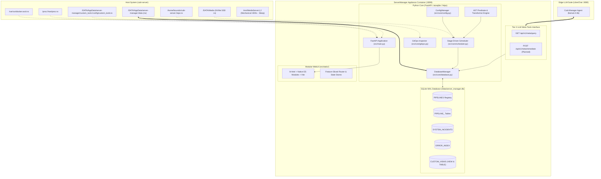
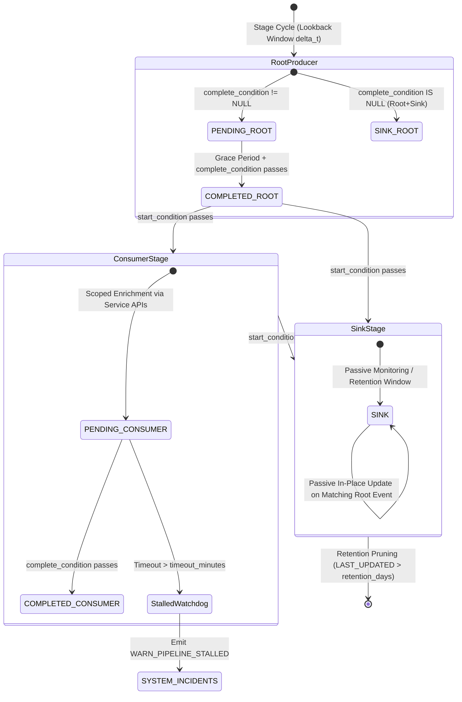
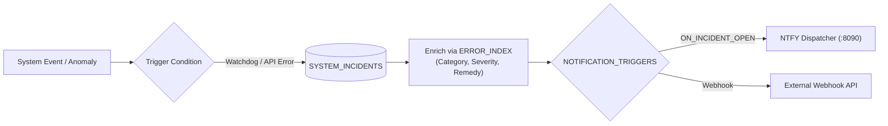

# ServerManager Platform Architecture & System Blueprint

**Document Version:** `v0.1.9`  
**Appliance Port:** `8099`  
**Primary Architecture:** Containerized FastAPI + SQLite WAL + Modular ES / `lit-html` WebUI  
**Status:** Living Architectural Specification  
**Language Standard:** English (Universal Codebase Standard)

---

## 1. Executive Summary & Appliance Scope

`server-manager` is an autonomous, containerized administration, universal telemetry, and cross-service pipeline orchestrator designed for homelab and media server environments.

Operating as an independent appliance on port **8099**, it bridges disparate homelab automation services (e.g., Sonarr, Radarr, Shoko Server, Jellyfin, AniBridge) into a unified, extensible data pipeline without polluting underlying services or requiring hardcoded schema migrations.

### Non-Negotiable Operational Constraints

1. **Read-Only Host Mounts (`:ro`)**:
   The container operates strictly in passive observation mode over host resources (`/DATA:ro`, `/var/run/docker.sock:ro`, `/proc:/host/proc:ro`, `/repo:ro`).
2. **Pragmatic Anti-Wake Storage Policy**:
   Automated background daemons, ingestion loops, and health checks MUST NEVER trigger physical spin-up of idle mechanical hard drives (`/mnt/MediaServer1`, `/mnt/MediaServer2`). All file evaluations rely on NVMe SSD symlink inspection (`os.readlink()`), `/host/proc/diskstats`, and in-memory caches.
3. **Decoupled Three-Tier Telemetry Architecture (Rule 9)**:
   - **Tier 1 (Autonomous Background Ingestion)**: Stage-driven loops poll upstream APIs, normalize payloads, resolve enrichment endpoints lazily, and write structured records into SQLite pipeline tables.
   - **Tier 2 (Structured Database Storage)**: Local SQLite database (`PIPELINES`, `PIPELINE_<SLUG>`, `SYSTEM_INCIDENTS`, `ERROR_INDEX`, `CUSTOM_VIEWS`, and persistent materialized custom tables) stores pre-filtered records with concurrency handled via WAL mode.
   - **Tier 3 (Stateless LLM Agent)**: Edge AI agents interact **strictly and exclusively** with Tier 2 structured data via management APIs (`/api/v1/meta/query`). The LLM never reads raw container logs or executes arbitrary host commands.
4. **Zero Backward Compatibility / Zero Duct-Tape Standard**:
   Architectural refactoring eliminates dead code, legacy shims, and brittle fallback logic. All schema evolutions and endpoint namespaces are explicit and strictly typed.

---

## 2. End-to-End System Topology



---

## 3. Container Architecture & Host Mounts

The container runs as an unprivileged service (`PUID=1000`, `PGID=1000`, `UMASK=002`) packaged with Python 3.12-slim and built-in static WebUI assets.

### Mount Specifications

| Host Path | Container Path | Mode | Purpose |
| :--- | :--- | :---: | :--- |
| `/DATA/AppData/server-manager` | `/data` | `rw` | Persistent storage: `server_manager.db` (WAL mode) and `settings.json`. |
| `/DATA/AppData/server-manager/custom_tools` | `/config/custom_tools` | `ro` | Sandboxed executable scripts (`.py`, `.sh`) triggered on operator demand. |
| `/var/run/docker.sock` | `/var/run/docker.sock` | `ro` | Passive container health, image status, and container state verification. |
| `/proc` | `/host/proc` | `ro` | Passive host telemetry: CPU load, memory utilization, and disk I/O stats. |
| `/home/facundo/cubi-server` | `/repo` | `ro` | Read-only GitOps tracking (`HEAD` commit, current branch, working tree state). |

---

## 4. Universal Dynamic Multi-Pipeline Engine

The core storage architecture supports one or multiple isolated pipeline tables (`PIPELINE_<SLUG>`, e.g., `PIPELINE_DEFAULT`) registered in the `PIPELINES` catalog table, designed to ingest and correlate records from any upstream HTTP JSON API without service-specific hardcoding.

### 4.1 Multi-Pipeline Registry & Dynamic Schema Mapper
- **Pipeline Registry (`PIPELINES`)**: Each pipeline defines an `ID`, `NAME`, `DESCRIPTION`, `TABLE_NAME` (`PIPELINE_<SLUG>`), `RETENTION_DAYS`, and `ENABLED` state. Stages can be assigned to one or multiple pipelines via `StageConfig.pipeline_ids`.
- **SQL Sanitization**: Target column names must strictly match the regex `^[A-Z0-9_]+$`. Any column violating this pattern is rejected at the API layer.
- **System Reserved Columns**: The following columns are protected and managed exclusively by the core engine on every `PIPELINE_<SLUG>` table:
  - `ID`: Autoincrement primary key.
  - `PIPELINE_KEY`: Unique tracking identifier across services (e.g. `sensor:500`).
  - `STAGE`: Current progression stage semantic slug (`TEXT`).
  - `STATUS`: Progression state (`PENDING`, `COMPLETED`, `SINK`).
  - `CREATED_AT`: Immutable item creation timestamp stamped strictly by ServerManager's internal UTC clock (`CURRENT_TIMESTAMP`) upon initial ingestion.
  - `LAST_UPDATED`: ISO timestamp updated strictly upon verified column value modifications or stage transitions.
- **Automated DDL Evolution**: Saving field mappings automatically triggers non-destructive SQLite migrations across all pipeline tables to which the service's stages are assigned:
  ```sql
  ALTER TABLE PIPELINE_<SLUG> ADD COLUMN "<COLUMN_NAME>" <DATA_TYPE>;
  ```
- **Column Renaming & Consolidation**: Renaming a target column for an existing `source_field` in settings updates the table schema (`RENAME COLUMN`) across pipelines and propagates the rename into `stage.service_mapping_scopes`.

### 4.2 Lazy Namespaced Multi-Enrichment Architecture
Primary events from upstream services frequently provide only foreign keys or summary attributes.
- `ServiceConfig.enrichment_endpoints` supports discrete namespaces:
  ```json
  "enrichment_endpoints": {
    "details": "/api/v1/items/{itemId}",
    "metadata": "/api/v1/meta/{details.metaId}"
  }
  ```
- **Lazy Namespace Filtering**: During stage execution, `_compute_required_enrichment_namespaces` inspects the active stage's `service_mapping_scopes` (plus transitive placeholder dependencies) and executes HTTP GET requests **exclusively** for the enrichment namespaces required by that stage's monitored fields.
- Payloads are nested under their namespace key in the ingestion context dictionary (`context["details"]`, `context["metadata"]`), eliminating attribute collisions.

### 4.3 Generic Dotted-Path List Projection (`extract_dotted_value`)
- Nested structures and arrays of objects are extracted using mandatory `[*]` array traversal syntax (e.g., `items[*].title`, `tags[*].name`, `genres[*]`). Traversal over arrays without explicit `[*]` returns `None` to prevent accidental projections.
- Explicit index traversal (e.g., `tags[0].name` or `tags.1.name`) remains supported for specific element access.
- Terminal `[*]` notation (e.g., `item.title[*]`) deterministically coerces single scalar values into single-element lists (`[val]`), enabling safe ingestion into accumulative array columns.

### 4.4 Clean Database Principle, List Unpacking & Cross-Service Array Merging
- **Null Normalization**: Empty strings, empty lists, empty dictionaries, and whitespace strings normalize to SQL `NULL`, preventing `"[]"` or `""` dead rows.
- **Transparent JSON List Unpacking**: When SQLite `TEXT` columns containing serialized JSON arrays (`'["a", "b"]'`) are loaded into `PredicateEvaluator` or `TransformerEvaluator` (`SafeContext`), `parse_json_list_if_str` automatically deserializes them into native Python `list` objects so expressions such as `len(TAGS) > 0` and `'critical' in TAGS` work identically on payload lists and persisted database columns.
- **Type-Safe Merging & Deduplication**: Downstream stages accumulating array data use `merge_field_value` (backed by unified `deduplicate_list` in `src/core/transformers.py`) to deduplicate and store a unified JSON array. Scalar-to-list and list-to-scalar cross-updates are safely rejected with error telemetry.

### 4.5 Dual-Mode View & Persistent Custom Table Builder (`VIEW` & `TABLE`)
Operators can project pipeline data into two complementary structures managed via `/api/v1/views` and registered in `CUSTOM_VIEWS`:
1. **Virtual SQL Views (`MODE = 'VIEW'`)**: Lightweight `CREATE VIEW` projections for immediate ad-hoc inspection and temporary validation.
2. **Persistent Custom Tables (`MODE = 'TABLE'`)**: Materialized SQLite tables populated from pipeline queries via `UPSERT` (`ON CONFLICT(SYNC_KEY_COLUMN) DO UPDATE`), preserving historical records even after source rows are pruned from `PIPELINE_<SLUG>` by retention policies. Supports both manual synchronization (`POST /api/v1/views/{name}/sync`) and automated periodic synchronization every $T_s$ seconds (`REFRESH_INTERVAL_SECONDS`), queryable via `GET /api/v1/views/{name}/data`.

### 4.6 Decoupled Developer API Sandbox & Payload Inspector
The API Sandbox (`POST /api/v1/pipeline/sandbox/enrichment`) provides an isolated environment for operators to simulate, verify, and register secondary enrichment endpoints before committing them into pipeline stages.
- **Database Decoupling**: Sandbox testing does not require an existing database record ID; `record_id` is optional (`pipeline_id` defaults to `"default"` when used).
- **Direct Upstream Sampling**: Operators can test against live upstream services by specifying a `sample_endpoint`.
- **Arbitrary Custom Mock Context**: Operators can provide custom JSON mock payloads (`custom_context`) to test edge cases or prototype transformation logic.
- **Unified Enrichment Execution**: Both the Sandbox and `TaskScheduler` share the same `fetch_enrichment_payloads` engine in `src/core/scheduler.py`.

---

## 5. Stage-Driven Tri-State DAG Engine (`PIPELINE_<SLUG>`)

Processing follows a forward-only, directed acyclic graph (DAG) driven by per-stage execution intervals (`StageConfig.interval_seconds`).



### 5.1 Stage Taxonomy & Stage-Driven Execution

1. **Root Producer Stage (`start_condition IS NULL`)**:
   - Runs on its own `interval_seconds` cycle (`_stage_loop`), polling all assigned services in `stage.service_ids` across all assigned `stage.pipeline_ids`.
   - Filters incoming events using a relative lookback window ($\Delta t = \text{interval\_seconds}$) referenced against the upstream HTTP `Date` response header (with fallback to ServerManager UTC) and supports `{interval_seconds}`, `{interval_minutes}`, `{lookback_iso}`, and `{lookback_unix}` placeholders in `poll_endpoint`.
   - Stamps `CREATED_AT` strictly with ServerManager's internal UTC clock.
   - **Root + Sink Mode**: If `complete_condition` is empty/`None`, newly ingested rows enter `STATUS = 'SINK'` directly. Otherwise, they enter `STATUS = 'PENDING'` and transition to `STATUS = 'COMPLETED'` once `grace_period_minutes` elapses and `complete_condition` evaluates to `True`.
2. **Consumer Stage (`start_condition != NULL` and `complete_condition != NULL`)**:
   - Runs on its own `interval_seconds` cycle, evaluating rows in this stage (`PENDING`) and promoting qualifying `COMPLETED` rows from earlier stages (`order < current_stage.order`).
   - Executes assigned service enrichment tasks lazily for the stage's `service_mapping_scopes`.
   - Once `complete_condition` evaluates to `True`, the row advances to `STATUS = 'COMPLETED'`.
3. **Passive Sink Stage (`start_condition != NULL` and `complete_condition IS NULL`)**:
   - **100% Passive**: Does not spawn an active polling task.
   - Qualifying rows from upstream stages transition into the Sink Stage with `STATUS = 'SINK'`.
   - **Passive In-Place Updates**: If a new event arrives during a Root Stage cycle with the same `PIPELINE_KEY` as an existing row (even if that row is in `SINK`), the Root Stage updates the changed monitored fields in-place and updates `LAST_UPDATED = CURRENT_TIMESTAMP` without resetting `STAGE` or `STATUS`.
   - **Retention Pruning**: The background retention loop (`_retention_loop`) deletes exclusively rows where `STATUS = 'SINK'` and `LAST_UPDATED < datetime('now', '-N days')` according to each pipeline's `retention_days`.

### 5.2 Unidirectional Progression & Stage Skipping
- Progression is strictly forward: a row at stage order $N$ can only advance to stage order $M$ where $M > N$.
- Dynamic branching: items can skip intermediate consumer stages if their `start_condition` predicates do not match and transition directly into a downstream Consumer or Sink stage.

### 5.3 AST-Based Safe Expression Evaluation & Transformer Engine
Predicates and conditional transformers are parsed and evaluated using Python's standard `ast` module and sandboxed execution environments.
- **Predicates (`src/core/predicates.py`)**:
  - Zero arbitrary code execution (`eval` is strictly forbidden for predicates).
  - Supports boolean operators (`AND`, `OR`, `NOT`), comparisons (`==`, `!=`, `<`, `<=`, `>`, `>=`), inclusion (`IN`, `NOT IN`), and safe function calls (`len`, `lower`, `upper`, `str`, `int`, `float`, `bool`).
  - Normalizes SQL-style keywords (`IS NULL`, `IS NOT NULL`, `TRUE`, `FALSE`) into Python-compatible AST tokens and automatically unpacks serialized JSON list strings from SQLite columns.
- **Single-Line Multi-Branch Transformers (`src/core/transformers.py`)**:
  - Evaluates field mapping transformers using single-line human-friendly branching (`if ... then ... else if ... then ... else ...`), `elif`, and `return` syntaxes.
  - Runs in a restricted sandbox (`safe_globals = {"__builtins__": {}}`) with safe injected helpers (`str`, `int`, `bool`, `len`, `lower`, `upper`, `merge`) and case-insensitive `SafeContext` that automatically unpacks JSON list strings.

### 5.4 Grace Periods & Watchdog Timeouts
- **Ingestion Grace Period (`grace_period_minutes`, default 10m)**:
  Enforced in `reconcile_stages` for Root Stages (`start_condition IS NULL`), holding newly ingested `PENDING` items until `elapsed_minutes >= grace_period_minutes` before allowing `complete_condition` promotion.
- **Stage Watchdog Timeout (`timeout_minutes`, default 30m)**:
  Enforced in `reconcile_stages`: if a row remains in `PENDING` state longer than `timeout_minutes` since `LAST_UPDATED`, the watchdog emits a deduplicated `WARN_PIPELINE_STALLED` incident into `SYSTEM_INCIDENTS`.

### 5.5 Granular Stage-Scoped Field Mapping Selection (`service_mapping_scopes`)
Stages can selectively restrict which field mappings of an assigned service are evaluated during execution, preventing unintended column overwrites across different lifecycle stages sharing the same service.
- **Scope Model**: Configured via `service_mapping_scopes: Dict[str, list[str]]` on `StageConfig`, mapping `service_id` to a list of allowed uppercase column names (`target_column`).
- **Default Fallback**: If a service key is omitted or contains an empty list, the engine evaluates all configured mappings for that service.
- **Lazy Enrichment & Scoped Execution**: Both Root ingestion (`_ingest_root_service_for_stage`) and Consumer enrichment (`_execute_consumer_enrichment`) filter HTTP enrichment requests and field mapping evaluations strictly to the active stage's `service_mapping_scopes`.
- **Schema Sanitization & Rename Propagation**: When settings are saved, orphaned service keys and unmapped columns are automatically pruned from scopes, and unambiguous `source_field` column renames are propagated across all pipeline tables and referencing stage scopes.

---

## 6. Incident & Notification Subsystem



### 6.1 Data Model
- **`ERROR_INDEX`**: Catalog of known error patterns, severities (`CRITICAL`, `WARNING`, `INFO`), and operator remediation runbooks (`REMEDY`).
- **`SYSTEM_INCIDENTS`**: Normalized tracking table of active and resolved anomalies with audit timestamps (`CREATED_AT`, `RESOLVED_AT`) and resolution notes (`RESOLUTION_NOTE`).

### 6.2 Notification Dispatcher
- Triggers are evaluated against configured events (`ON_INCIDENT_OPEN`, `ON_INCIDENT_RESOLVED`, `ON_PIPELINE_COMPLETE`, `ON_DEPLOY_SUCCESS`).
- Dispatches formatted payloads to NTFY topics or HTTP webhooks with configurable priority, tags, and message templates.

---

## 7. Decoupled Tier 3 LLM Meta-Tools Interface (Rule 9)

To ensure small edge models (`llama3.2:3b`) remain accurate and avoid context saturation, `server-manager` exposes a high-efficiency meta-tool API.

### 7.1 Single Universal Query Endpoint (`GET /api/v1/meta/query`)
Replaces multiple individual API tools with a single parameter-driven endpoint:

```
GET /api/v1/meta/query?target={overview|incidents|pipeline|catalog|gitops|errors}&filter={filter}&limit={limit}
```

- **Token Footprint**: Prefill context requires less than 80 tokens.
- **HATEOAS Guided Remediation**: When an incident is returned, the response embeds pre-calculated remediation parameters (`remedy`, `incident_id`, `suggested_action`). The LLM does not hallucinate parameters; it confirms the action with the user and executes the verified remedy.

---

## 8. Custom Tools Bridge

Located in `/config/custom_tools/`, custom tools are sandboxed, standalone executable scripts (`.py`, `.sh`).
- Discovered automatically by the API (`GET /api/v1/tools`).
- Execution is triggered on demand via `POST /api/v1/tools/{name}/run`.
- Real-time output streaming is rendered in the WebUI live console.
- Execution timeout is enforced (default: 60s) to prevent runaway processes.
